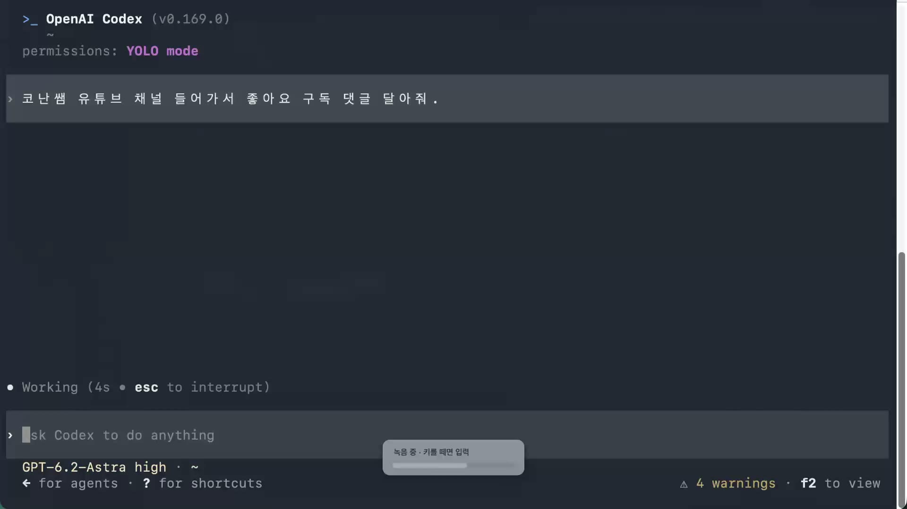

[한국어](README.md) · [English](README.en.md)

# murdic

Hold right Option, speak Korean, and release to paste a cleaned-up sentence at your cursor. Dictation runs on your Mac.

**[Watch the 33-second demo ↗](https://murdic.netlify.app/en/#demo)** · [Video file](site/assets/demo.mp4) · [Before and after](https://murdic.netlify.app/en/#examples)

[](https://murdic.netlify.app/en/#demo)

## Install in three lines

Use an Apple Silicon Mac. We tested macOS 26.5 with Homebrew Python 3.14.6. Install the Command Line Tools with `xcode-select --install` and Homebrew Python with `brew install python`. The Murmur core requires Python 3.11 or later.

```sh
git clone https://github.com/jkf87/murdic.git && cd murdic
/opt/homebrew/bin/python3 -m venv .venv && .venv/bin/pip install 'git+https://github.com/jkf87/murmur.git@master#subdirectory=core'
make run
```

The first launch downloads the Whisper model. Once cached, default dictation works offline. The app lives at `~/Applications/murdic.app`. Keep the checkout in place because it contains the Python environment the app uses.

## Dictate into a text field

1. Place your cursor in an app that accepts paste, such as Notes.
2. Hold **right Option** while speaking. A floating meter shows your microphone level.
3. Release the key. murdic removes fillers and immediate repeats, resolves common spoken corrections, and pastes the result.

The menu lets you switch to right Control. Add names to `hints.txt`, one per line, in the settings folder. The next transcription will use them as hints. murdic saves clipboard items and formats before pasting, then restores them after 450 ms. Anything you copy in the meantime takes priority.

## Check or change your microphone

The **마이크** (Microphone) menu shows the active input. Choose a device there or in **설정 및 권한…** (Settings & Permissions). System Default follows macOS. A specific microphone is remembered across launches. Press **3초 테스트** and speak for three seconds to check the meter without holding the shortcut. The test does not save audio.

#### After-install checklist

- [ ] Run `make run`, select the built-in microphone in Settings & Permissions, and speak during the three-second test. Check the meter.
- [ ] In Notes, hold right Option, check the device name beside the recording meter, speak, then release and verify the pasted sentence.
- [ ] Quit and reopen to verify the selection persists. Select a USB mic and unplug it during recording. The take should stop and the next take should use the system default, even after the USB mic returns.
- [ ] Select System Default and change the macOS input. Verify both selectors update. Record with a muted input and check for the quiet-input notice with its device name.

## Permissions

Allow **Microphone** for recording and **Accessibility** for pasting. If macOS requires **Input Monitoring** for the global shortcut, enable it too. To add a missing entry, click **+**, press **⌘⇧G**, and enter `~/Applications/murdic.app`. The settings window shows a green check for each available permission. Reopen the app if macOS asks.

## Measured latency

Apple M5, 32 GB, macOS 26.5. The input was a five-second Korean WAV synthesized with Yuna. The LLM hook was off.

| Interval | Result |
| --- | --- |
| Python process launch to cached model ready | 2,101 ms |
| Warm WAV request to insertion in an AppKit text view, five runs | 240 / 242 / 293 / 410 / 363 ms |
| Median / maximum | **293 / 410 ms** |

Physical key release to visible text in another app also includes closing the recording and the target app handling paste. Run `make benchmark` to repeat the WAV measurement.

## Language, privacy and limits

- **Korean-first.** The app passes Korean as the Whisper language and applies Korean cleanup rules. English names and terms can appear in Korean speech. In a test with one English sentence read by Samantha, the model returned Korean text with a different meaning. There is no dedicated English dictation mode.
- The overlay shows a level meter while you speak. Transcription starts on release. The cleanup rules can shorten intentional repetition.
- With default settings, audio and text are processed locally. Temporary recordings are removed after processing or cancellation. Enabling an external LLM hook sends the transcript to the service you choose.
- See the [development notes](docs/DEVELOPMENT.md) for the WAV CLI, tests, and optional hook.

## License and credits

The original murdic app, documentation, and website use the [MIT License](LICENSE). Voice activity detection and Whisper transcription use the separately installed Python core from [jkf87/Murmur](https://github.com/jkf87/murmur). Its README lists its license as **Private**. The upstream core and model retain their own terms. [Upstream license statement](https://github.com/jkf87/murmur/blob/0c0c409de45504686ad080bf3c576816444b4fa4/README.md#license)
