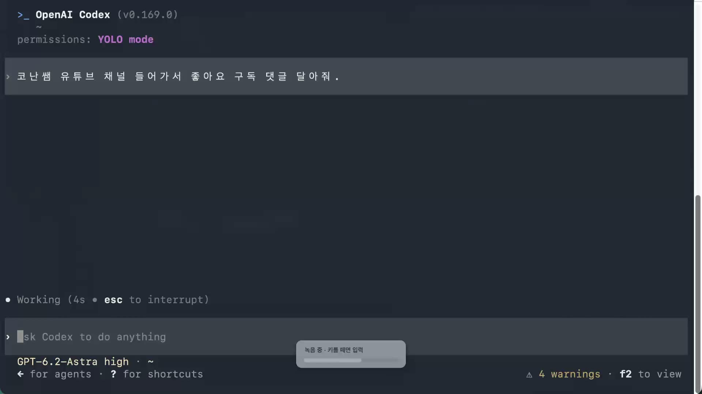

[한국어](README.md) · [English](README.en.md)

# 머딕 · murdic

오른쪽 Option을 누르고 말하면, 내 Mac에서 한국어를 정리해 커서에 입력합니다.

**Windows 초기 지원:** [Windows 설치 및 사용법](docs/WINDOWS.md). 오른쪽 Ctrl을 누르고 말하면 CPU에서 한국어를 인식해 입력합니다.

**[33초 데모 보기 ↗](https://murdic.netlify.app/#demo)** · [영상 파일](site/assets/demo.mp4) · [정리 전후 예시](https://murdic.netlify.app/#examples)

[](https://murdic.netlify.app/#demo)

## 세 줄로 설치

Apple Silicon Mac에서 사용합니다. 검증 환경은 macOS 26.5, Homebrew Python 3.14.6입니다. 먼저 `xcode-select --install`로 Command Line Tools를, `brew install python`으로 Python을 준비하세요. Murmur 코어는 Python 3.11 이상을 요구합니다.

```sh
git clone https://github.com/jkf87/murdic.git && cd murdic
/opt/homebrew/bin/python3 -m venv .venv && .venv/bin/pip install 'git+https://github.com/jkf87/murmur.git@master#subdirectory=core'
make run
```

처음에는 Whisper 모델을 다운로드합니다. 준비가 끝나면 기본 설정으로 오프라인 받아쓰기를 사용할 수 있습니다. 앱은 `~/Applications/murdic.app`에 설치됩니다. 앱이 사용하는 Python 환경이 들어 있으므로 설치한 프로젝트 폴더를 유지하세요.

## 받아쓰기

1. 메모처럼 붙여넣기가 가능한 앱에서 커서를 놓습니다.
2. **오른쪽 Option**을 누른 채 말합니다. 작은 창에서 마이크 레벨을 확인할 수 있습니다.
3. 키를 떼면 필러·반복·자기수정을 정리한 문장이 들어갑니다. 예를 들어 “내일 세 시, 아니 네 시에 만나요”는 “내일 네 시에 만나요.”가 됩니다.

메뉴에서 단축키를 오른쪽 Control로 바꿀 수 있습니다. **힌트·설정 폴더 열기**에서 `hints.txt`에 고유명사를 한 줄씩 넣으면 다음 전사부터 반영됩니다. 입력 전 클립보드의 서식과 여러 항목을 보관하고 ⌘V 전송 450 ms 후 복원합니다. 그사이 새로 복사한 내용은 보존합니다.

## 마이크 확인·바꾸기

메뉴 위쪽의 **마이크: 장치 이름**에서 실제 입력을 확인하세요. 하위 메뉴나 **설정 및 권한…**에서 마이크를 바꿀 수 있습니다. **시스템 기본값**은 macOS의 입력 변경을 따르고, 장치를 직접 선택하면 다음 실행에도 그 선택을 사용합니다. **3초 테스트**를 누르고 말하면 단축키 없이 레벨을 확인할 수 있습니다. 테스트 음성은 파일에 저장하지 않습니다.

#### 설치 후 확인표

- [ ] `make run` 후 **설정 및 권한…**에서 내장 마이크를 고르고 **3초 테스트** 중 말해 레벨이 움직이는지 확인합니다.
- [ ] 메모에 커서를 놓고 오른쪽 Option을 누릅니다. 녹음 창의 마이크 이름을 확인하고 문장을 말한 뒤 키를 떼어 입력 결과를 확인합니다.
- [ ] 앱을 종료했다가 다시 열어 선택이 유지되는지 확인합니다. USB 마이크를 고른 뒤 녹음 중 분리하면 녹음이 취소되고 기본 마이크로 바뀝니다. USB를 다시 연결한 뒤에도 다음 녹음은 기본 마이크를 사용합니다.
- [ ] **시스템 기본값**을 선택하고 macOS 입력을 바꿔 메뉴·설정 표시가 바뀌는지 확인합니다. 음소거한 마이크로 녹음하면 키를 뗀 뒤 마이크 이름과 무음 안내가 표시됩니다.

## 권한

앱의 설정 창에서 **마이크**를 허용하고 **손쉬운 사용**을 켜세요. 전역 단축키에 필요한 경우 **입력 모니터링**도 켭니다. 목록에 앱이 없으면 **+ → ⌘⇧G**로 `~/Applications/murdic.app`을 선택하세요. 허용된 항목은 앱에 초록색 체크가 표시됩니다. macOS가 재실행을 요청하면 앱을 다시 엽니다.

## 지연 실측

Apple M5 · 32 GB · macOS 26.5. Yuna로 만든 5초 한국어 WAV를 사용했고 LLM 훅은 껐습니다.

| 측정한 구간 | 결과 |
| --- | --- |
| Python 프로세스 시작 → 캐시된 모델 준비 | 2,101 ms |
| 모델 준비 후 WAV 요청 → AppKit 텍스트 뷰 삽입, 5회 | 240 / 242 / 293 / 410 / 363 ms |
| 중앙값 / 최댓값 | **293 / 410 ms** |

실물 키 해제부터 외부 앱에 글자가 보일 때까지는 마이크 파일 마감과 대상 앱의 처리 시간이 더해집니다. `make benchmark`로 위 구간을 다시 측정할 수 있습니다.

## 한계와 데이터 처리

- 전사 언어와 정리 규칙은 한국어 기준입니다. 한국어 문장에 섞인 영어 단어는 처리할 수 있지만 인식 결과는 달라집니다. Samantha로 읽은 영어 문장 한 건은 뜻이 달라진 한국어로 전사됐습니다. 현재 영어 전용 모드는 없습니다.
- 녹음 중에는 마이크 레벨이 표시됩니다. 전사문은 키를 뗀 뒤 나옵니다. 기본 규칙은 의도적인 반복도 줄일 수 있습니다.
- 기본 전사와 정리는 Mac에서 실행합니다. 녹음은 임시 파일에 두고 처리·취소 후 삭제합니다. 선택적 외부 LLM 훅을 직접 켜면 해당 서비스로 정리할 텍스트가 전송됩니다.
- 설치와 테스트, 훅 사용법은 [개발 문서](docs/DEVELOPMENT.md)에 있습니다.

## 라이선스와 크레딧

머딕이 작성한 앱·문서·사이트에는 [MIT 라이선스](LICENSE)를 적용합니다. 음성 감지와 Whisper 전사에는 [jkf87/Murmur](https://github.com/jkf87/murmur)의 Python 코어를 별도 설치해 사용합니다. Murmur의 README는 라이선스를 **Private**로 표기합니다. 코어와 모델에는 각각 업스트림 조건이 적용됩니다. [Murmur 라이선스 표기](https://github.com/jkf87/murmur/blob/0c0c409de45504686ad080bf3c576816444b4fa4/README.md#license)
